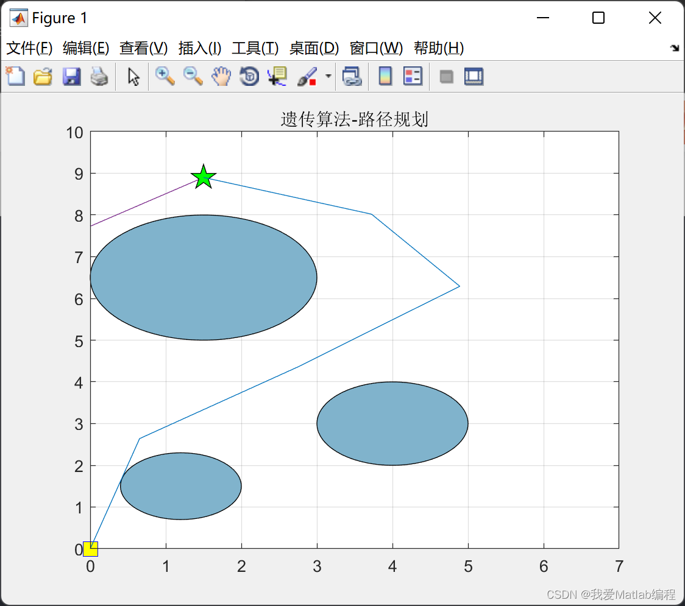
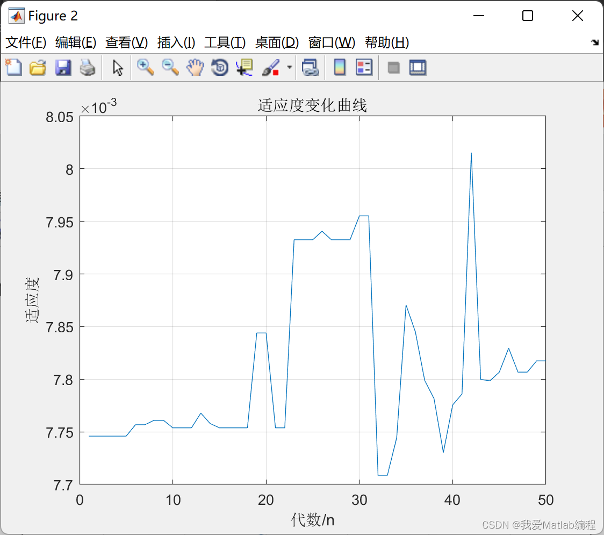

# Path Optimization Problem Based on Genetic Algorithm and Ant Colony Optimization (Matlab Code Implementation)

​  
Contents
1. Overview
2. Matlab code
3 Running results
1. Overview In 1959, Dantzig and Ramser proposed the first problem of vehicle routing optimization after conducting experiments and contemplations. Delivery is an important aspect in logistics transportation, accurately selecting the delivery vehicle route can effectively shorten transportation time, reduce transportation costs, meet customer demands, etc. The problem of finding the optimal delivery route has become one of the hot research topics. Initially, the Ant Colony Algorithm was studied for the Traveling Salesman Problem, but it has now been widely applied to many problems seeking the optimal solution.For example, Zheng Juanyi and others use ant colony algorithm to find the optimal path of delivery vehicles. Zhang Yinling and others use ant colony algorithm to find the optimal path of mobile robot. Lu Fengling, Bai Junqiang and others use ant colony algorithm to find the optimal path P~ for drones. The ant colony algorithm is applied to solve the problem of optimal travel routes. Wang Yong et al. "Utilize the ant colony algorithm to solve the VNF layout network problem." Zhang Xiaolin and others from the perspective of green environmental protection. On fuel consumption. Construct a path optimization model constrained by pollutant emissions and other factors. Use ant colony algorithm to find the optimal path. It can be seen that ant colony algorithm can solve many practical problems. However, there are still deficiencies. So, the maximum and minimum ant systems, as well as hybrid ant systems, were proposed. To a certain extent, it has improved the computational efficiency.Although most literature has been thoroughly researched on path optimization.
This article is based on the path optimization problem of genetic algorithm and ant optimization algorithm.
2 MatlabCodefunction [ genxx,genyy ] = addallgen( genx,geny,xs,ys,xt,yt)\n%%%%%%%%%%%%%%%%%%%%%%%%%%%%%%%%%%%%%%%%%%%%%%%%%%%%%%%%%%\n% addallgen(): Store the starting point and target point in the population.\n% genx geny are the population xs ys,xt,yt respectively.\n% genxx genyy return the coordinates of the start point and target point\n%%%%%%%%%%%%%%%%%%%%%%%%%%%%%%%%%%%%%%%%%%%%%%%%%%%%%%%%%%\n[sizex,sizey] = size(genx);     % Get the population dimension\ngenxx = zeros(sizex,sizey+2);   % Initialize the population in x direction\ngenxx(:,1) = ones(sizex,1)*xs;  % Combine the target point and starting point separately.\ngenxx(:,end) = ones(sizex,1)*xt;% Individuals are added\ngenxx(:,2:end-1)=genx;\ngenyy = zeros(sizex,sizey+2);   %y direction, same operation\ngenyy(:,1) = ones(sizex,1)*ys;\ngenyy(:,end) = ones(sizex,1)*yt;\ngenyy(:,2:end-1)=geny;\nend\n  
3. Running Results Editing
Edit

## Images

<!-- PAYMENT_BLOCK -->

## Get this dataset

- Payment link (Stripe): [Buy now](https://buy.stripe.com/3cs8yP7sY87d0vu9AB)
- Payment QR code: 

<!-- /PAYMENT_BLOCK -->
